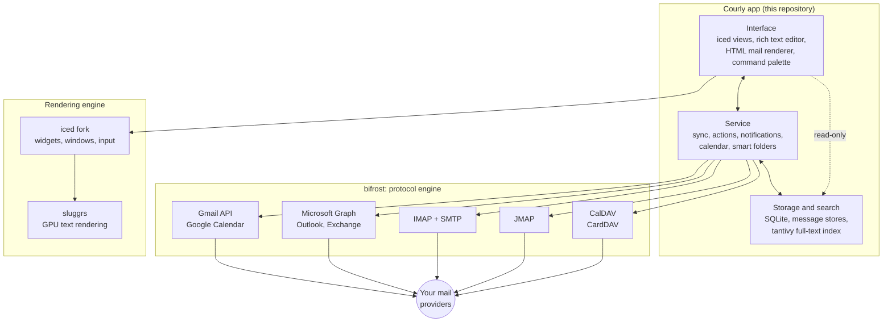
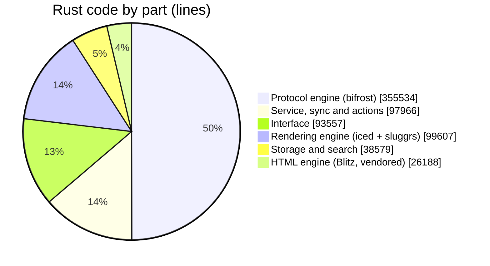

<p align="center">
  
</p>

<p align="center">
  <a href="https://github.com/Soflutionltd/courly/releases/latest"></a>
  &nbsp;
  
</p>

<p align="center">
  <a href="https://github.com/Soflutionltd/courly/releases/latest"></a>
  
  
  <a href="LICENSE"></a>
  
</p>

---

**Courly** is a desktop email client that brings Gmail, Outlook and Exchange, iCloud and any IMAP or JMAP mailbox into one window, with the calendar and the address book right beside your mail. It is written in Rust and draws every pixel itself on the GPU, so it opens in an instant, scrolls smoothly through tens of thousands of messages, and keeps your mail on your own computer.

## Why Courly

<table>
  <tr>
    <td width="33%" valign="top">
      <h3>⚡ Native and fast</h3>
      No web view and no Electron. The interface is drawn by the GPU through <a href="https://iced.rs">iced</a> and wgpu, and the search index answers as you type.
    </td>
    <td width="33%" valign="top">
      <h3>📬 Every account, one inbox</h3>
      Gmail, Microsoft 365 and Exchange, iCloud, Fastmail, and any IMAP or JMAP server, side by side or merged in a single unified view.
    </td>
    <td width="33%" valign="top">
      <h3>🔒 Your mail stays yours</h3>
      Everything is stored on your Mac. Passwords and tokens are encrypted, remote images and tracking pixels are blocked, and there is no Courly server.
    </td>
  </tr>
</table>

## Features

**Mail**
- One sidebar for every account, with a unified inbox, favorites and pinned searches
- Conversation threading that follows replies across folders and accounts
- Drag messages onto any folder, or move them from the toolbar and the right-click menu
- Instant full-text search, including inside attachments, with people and messages suggested as you type
- Smart folders driven by a query language (dates, senders, labels, flags, attachments)
- Scheduled send, snooze, flags, pins and Gmail labels
- Command palette for every action, with keyboard shortcuts throughout

**Writing**
- Rich text editor with signatures
- Recipient autocomplete from every address you have ever written to
- Attachment compression for images, PDFs and Office documents before sending
- Cloud attachments through OneDrive and Google Drive

**Calendar and contacts**
- Month, week and day views, with invitations answered right from the message
- Google Calendar, CalDAV and JMAP calendars
- CardDAV address books, and contact import from CSV, Excel and vCard files

**Privacy and security**
- Local-first storage in SQLite, with compressed message stores
- Credentials encrypted with AES-256-GCM
- HTML sanitizing, remote image blocking, tracking pixel and tracking link removal
- BIMI brand logos verified before they are shown

**Everyday comfort**
- Light, dark or automatic theme
- English and French interface
- Signed, notarized builds that update themselves

## How Courly is built

Courly is made of four parts. The application itself lives in this repository; the protocol engine and the rendering engine live in their own repositories so they can evolve and be tested on their own.



The interface never writes to the database. Every change goes through the service, which applies it locally first, so the app answers at once, and then sends it to the provider in the background.

### What the code is made of

Measured on the Rust sources (non-blank lines) of each repository:



| Repository | What it does | Size |
| --- | --- | --- |
| [**courly**](https://github.com/Soflutionltd/courly) | The app: 32 crates for the interface, service, storage, search and calendar | 230,000 lines |
| [**bifrost**](https://github.com/Soflutionltd/bifrost) | Gmail, Microsoft Graph, IMAP, SMTP, JMAP, CalDAV and CardDAV clients, in 12 crates | 356,000 lines |
| [**iced**](https://github.com/Soflutionltd/iced) | Fork of the iced GUI toolkit used by Courly | 90,000 lines |
| [**sluggrs**](https://github.com/Soflutionltd/sluggrs) | GPU text rendering for iced | 10,000 lines |

### Main building blocks

| Area | Crates | Built on |
| --- | --- | --- |
| Interface | `app`, `rte`, `mail-html`, `cmdk`, `iced-drop` | iced, wgpu, Blitz |
| Service | `service`, `sync`, `core`, `calendar`, `smart-folder`, `ai` | Tokio |
| Storage | `db`, `db-read`, `stores`, `seen` | SQLite (rusqlite), LZ4 |
| Search | `search` | tantivy |
| Attachments | `squeeze`, `import` | mozjpeg, oxipng, lopdf |
| Security | `crypto-key`, `common` | AES-256-GCM, ammonia |

## Install

1. Click **Download for Mac** above and take the `.app.tar.gz` file of the latest version.
2. Open it: macOS unpacks the app.
3. Drag **Courly** into your **Applications** folder and open it.

Courly is signed and notarized by Apple. It checks for new versions on its own and offers to install them.

**Requirements:** a Mac with Apple silicon (M1 or later) and macOS 13 Ventura or later. Builds for Windows and Intel Macs are coming.

## Build from source

Courly builds against its sibling repositories, which must sit next to it:

```sh
mkdir courly-workspace && cd courly-workspace
git clone https://github.com/Soflutionltd/courly.git
git clone --branch ratatoskr https://github.com/Soflutionltd/bifrost.git
git clone https://github.com/Soflutionltd/sluggrs.git
git clone --branch sluggrs https://github.com/Soflutionltd/iced.git sluggrs/repos/iced

cd courly
cargo +1.99.0 run -p runner --features dev-seed   # demo data, no account needed
cargo +1.99.0 build --release -p runner           # optimised build
```

You need [Rust](https://rustup.rs) 1.99 and, on macOS, the Xcode command line tools.

## Contributing

Ideas, bug reports and pull requests are welcome: that is the whole point of publishing the code.

1. Open an issue to describe the bug or the change you have in mind.
2. Fork the repository and open a pull request.
3. On your first pull request, a bot asks you to sign the [Contributor License Agreement](CLA.md) with a one-line comment. You keep the copyright to your work.

Before sending, please run `cargo +1.99.0 clippy --workspace --all-targets` and `cargo +1.99.0 test --workspace`.

## License

Courly is **source-available** under the [PolyForm Shield License 1.0.0](LICENSE).

| You may | You may not |
| --- | --- |
| Download, read and build the full source code | Publish or sell a product that competes with Courly, |
| Use Courly for yourself or inside your company | free or paid, built from this code |
| Modify it for your own use |  |
| Contribute improvements back to this repository |  |

Parts of the code come from projects published under the Apache License 2.0 and remain available under that license; see [NOTICE](NOTICE). Third-party libraries keep their own licenses, listed inside the app.

<p align="center">
  <sub>Made by <a href="https://github.com/Soflutionltd">Soflution</a></sub>
</p>
