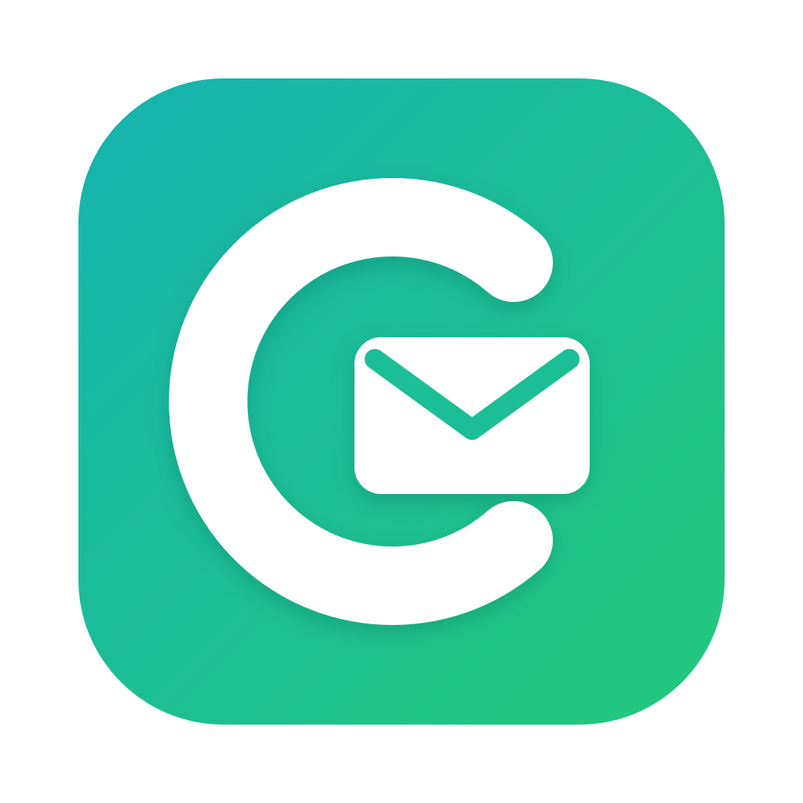

  
    
  <strong>Courly</strong> 
  <em>A desktop email client built in Rust, based on <a href="https://github.com/folknor/ratatoskr">Ratatoskr</a></em>

  
  
  

---

Multi-provider email client with calendar and contacts. Connects to Gmail, Microsoft Exchange, JMAP, and IMAP accounts from a single native UI built on [iced](https://iced.rs).

**Not ready for production use.**

Built with LLMs. See [LLM.md](LLM.md).

## Features

**Email**
- Four providers behind a unified interface - Gmail API, Microsoft Graph (Exchange/Outlook), JMAP, IMAP
- Smart threading (JWZ algorithm) with cross-account views
- Full-text search powered by [tantivy](https://github.com/quickwit-oss/tantivy)
- Smart folders with a query language (date ranges, labels, senders)
- Scheduled send, snooze, read receipts (MDN)
- HTML sanitization, tracking pixel detection, remote image blocking

**Compose**
- Rich text editor with formatting
- Attachment compression - images (mozjpeg, oxipng), PDFs (lopdf), Office documents
- Cloud attachments via OneDrive and Google Drive

**Calendar & Contacts**
- Google Calendar, CalDAV, JMAP calendar sync
- CardDAV contact management
- Contact import

**Privacy & Security**
- Local-first - all data stays on disk in SQLite + compressed content stores
- AES-256-GCM credential encryption
- AMP email stripping, URL tracking removal
- BIMI brand indicator verification

## License

Apache-2.0.
